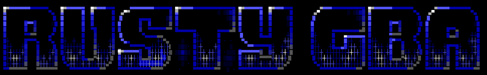
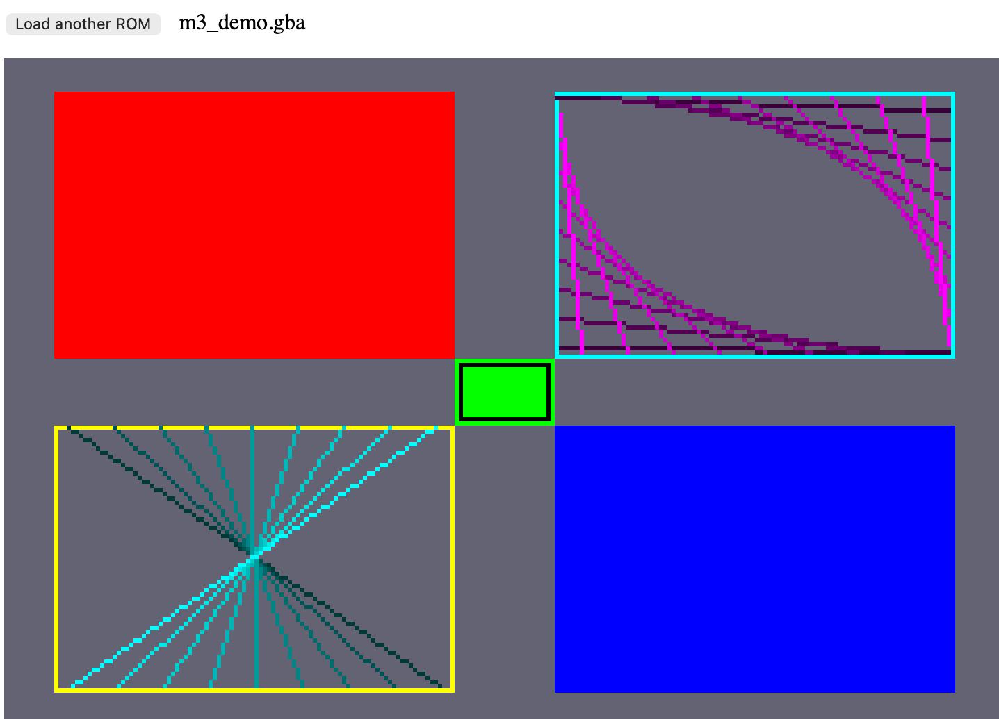
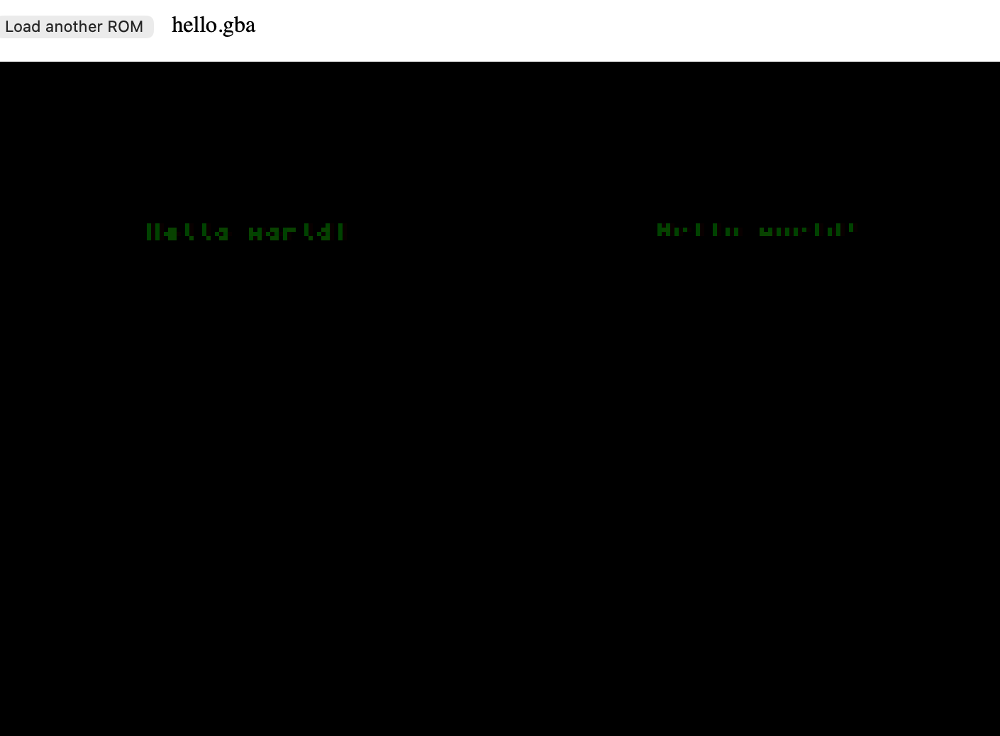

A Rust Emulator which is compiled through WASM to run on a React frontend. 
This project is my Bachelor's Final Project, done as a way to study emulation, CPU architecture (namely the ARM7TDMI) and various other things.

As of Oct. 31, 2026, I have implemented:
- Memory Bus Functionality:
    - 8/16/32-bit reads/writes
    - Cycle-accurate timings for each memory region

- CPU Functionality
    - Fetch / Decode / Execute Flow
    - All ARM Opcodes (except SWI) + Tests
    - All THUMB Opcodes (except SWI) + Tests
    - Cycle-accurate timings for each instruction
    - CPU Register operations

- Display
    - Display Mode 3
        - 
        - 

- Frontend
    - Basic screen showing actual outputted frames from loaded `.gba` files

## How To Use (so far)
Simply load a ROM (`.gba` file)

## Roadmap
1. Display Mode 4, 5
2. Simple Input Support
3. Interrupts 
4. DMA 
5. Display Mode 0, 1, 2
6. SWI / BIOS (HLE)
7. File Saving / Save States
8. Sound

## Legal note
I am not affiliated with Nintendo in any way, shape or form. I DO NOT distribute and/or ship ROMs or BIOS dumps, users have to come with those themselves. Always legally acquire GBA ROMs.
